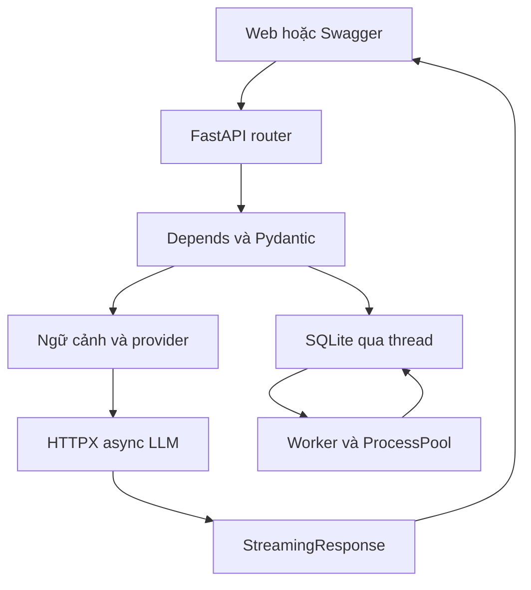

# StudyGateway AI Assistant API

**Đồ án Các công nghệ lập trình hiện đại: Tìm hiểu và xây dựng gateway trợ lý học tập tích hợp AI với FastAPI.**

Gateway nhận câu hỏi, phát câu trả lời theo **Server-Sent Events (SSE)**, nhận PDF/PPTX/TXT và trích xuất văn bản qua worker. Giao diện web nằm trong cùng dự án, dùng JavaScript thuần, không cần build frontend. FastAPI là framework chính; hệ thống không huấn luyện mô hình AI.

## Chạy trong vài phút

Yêu cầu Python 3.11 hoặc 3.12 và kết nối mạng để cài thư viện. Chạy lệnh từ thư mục có `pyproject.toml`.

### Windows PowerShell

```powershell
py -3.12 -m venv .venv
.venv\Scripts\Activate.ps1
python -m pip install --upgrade pip
python -m pip install -e ".[dev]"
Copy-Item .env.example .env
python scripts/serve.py
```

Nếu PowerShell chặn activate, dùng trực tiếp `.venv\Scripts\python.exe -m pip install -e ".[dev]"` và `.venv\Scripts\python.exe scripts/serve.py`.

### macOS hoặc Linux

```bash
python3 -m venv .venv
source .venv/bin/activate
python -m pip install --upgrade pip
python -m pip install -e '.[dev]'
cp .env.example .env
python scripts/serve.py
```

Mở **http://127.0.0.1:8000**. Nhập `dev-student-key` vào ô khóa truy cập gateway, bấm **Kết nối**. Tài liệu Swagger: http://127.0.0.1:8000/docs. Liveness: http://127.0.0.1:8000/health. Bấm Authorize trên Swagger để nhập `X-API-Key`.

## Hai chế độ vận hành

| Chế độ | Cần mô hình/key LLM | Kết quả |
|---|---|---|
| `PROVIDER=demo` (mặc định) | Không | Dòng chữ mô phỏng SSE và trích đoạn tài liệu, luôn có nhãn DEMO |
| `PROVIDER=openai_compatible` | Có dịch vụ hỗ trợ `/v1/chat/completions` và streaming | Câu trả lời/tóm tắt do LLM cung cấp |

**Demo không phải mô hình AI.** Bộ bàn giao đã kiểm thử đường tích hợp bằng HTTPX MockTransport và kiểm thử demo qua TCP. Chưa gọi mô hình thật hoặc đo chất lượng trả lời của mô hình thật trong môi trường xây dựng này.

### Kết nối LLM thật

Sửa `.env`, khởi động lại gateway:

```dotenv
PROVIDER=openai_compatible
LLM_BASE_URL=http://127.0.0.1:11434/v1
LLM_API_KEY=local
LLM_MODEL=qwen2.5:3b
API_KEYS=thay-bang-khoa-gateway-rieng
```

Ví dụ khi máy đã cài Ollama và đã tải được mô hình:

```bash
ollama pull qwen2.5:3b
ollama serve
```

`ollama serve` chỉ cần khi dịch vụ chưa chạy. Đây là ví dụ cấu hình, không khẳng định mô hình đã được tải hoặc chạy trong bộ bằng chứng. Có thể thay bằng dịch vụ tương thích khác: đặt base URL có `/v1`, API key và đúng model ID do nhà cung cấp cấp. Key LLM chỉ ở backend. Không dán key LLM vào ô `X-API-Key` trên giao diện.

Ứng dụng không tự đổi sang demo khi dịch vụ LLM hỏng. Trước khi có token: lỗi upstream thành HTTP 502 hoặc 504. Sau token đầu: lỗi thành SSE `error`, không phát `done`.

## Sử dụng tài liệu

1. Nhập khóa gateway và kết nối.
2. Tải file PDF có text, PPTX hoặc TXT UTF-8. API trả **202 Accepted**.
3. Giao diện theo dõi `queued → processing → ready/failed`. Chỉ tài liệu `ready` được chọn để hỏi.
4. Chọn tối đa 5 file, nhập câu hỏi, bấm Gửi. Đọc nội dung khi token tới.
5. Mở phần nguồn để xem trích đoạn đã gửi cho LLM. Chọn “Tóm tắt trích đoạn” để tóm tắt phạm vi đó.
6. Bấm Dừng để hủy stream. File lỗi có thể thử lại hoặc xóa. File đang chờ/đang xử lý phải hoàn tất trước khi xóa.

Mỗi API key có phạm vi tài liệu riêng, xác định bằng SHA-256 của key. Có thể cấu hình nhiều key bằng dấu phẩy, không chèn khoảng trắng. Đổi key đồng nghĩa đổi phạm vi truy cập; sao lưu key và dữ liệu phù hợp. Đây là xác thực bằng key phục vụ đồ án, chưa có đăng ký tài khoản/JWT hay quản trị người dùng.

### Giới hạn tài liệu và ngữ cảnh

- Tối đa 20 MiB/file, 80 trang/slide, 200.000 ký tự/file, 200 tài liệu toàn hệ thống.
- PDF scan không có text bị báo lỗi rõ ràng. Chưa có OCR. PPTX trích text trong slide XML, không đọc chữ trong ảnh, ghi chú hoặc chart.
- Chọn ngữ cảnh bằng trùng từ khóa, tối đa 6 cửa sổ text (1.400 ký tự/cửa sổ). **Không có embedding/vector database.**
- Tóm tắt chỉ gồm trích đoạn trong ngân sách ngữ cảnh, không đảm bảo toàn bộ một tài liệu dài.
- Metadata `sources` là các đoạn đưa vào prompt, không tự chứng minh LLM trích dẫn đúng. Người dùng phải kiểm tra nguồn gốc.

## API và ví dụ

| Method | Endpoint | Kết quả |
|---|---|---|
| GET | `/health` | 200, trạng thái worker và provider |
| POST | `/api/v1/documents` | 202, file vào hàng đợi |
| GET | `/api/v1/documents` | 200, danh sách của key hiện tại |
| GET | `/api/v1/documents/{id}` | 200, trạng thái/metadata |
| POST | `/api/v1/documents/{id}/retry` | 202, chỉ áp dụng file failed |
| DELETE | `/api/v1/documents/{id}` | 204, xóa file ready/failed |
| POST | `/api/v1/chat` | 200, JSON có response model |
| POST | `/api/v1/chat/stream` | 200, `text/event-stream` |

Ví dụ Bash (`curl.exe` trên PowerShell; hoặc dùng Swagger tránh khác biệt quoting):

```bash
curl -H 'X-API-Key: dev-student-key' -F 'file=@samples/lesson.txt' http://127.0.0.1:8000/api/v1/documents
curl -H 'X-API-Key: dev-student-key' http://127.0.0.1:8000/api/v1/documents
curl -N -H 'X-API-Key: dev-student-key' -H 'Content-Type: application/json' \
  -d '{"question":"Giải thích async trong FastAPI"}' http://127.0.0.1:8000/api/v1/chat/stream
```

Thay `document_ids` bằng ID trả về từ upload, chờ `ready`:

```json
{
  "question": "Tóm tắt nội dung chính",
  "document_ids": ["<UUID trả về từ upload>"],
  "task": "summarize",
  "temperature": 0.2,
  "max_tokens": 512
}
```

Khung SSE:

```text
event: meta
data: {"provider":"demo","sources":[]}

event: token
data: {"text":"Xin chào"}

event: done
data: {"characters":8}

```

Các sự kiện JSON được encode theo một dòng `data`; mỗi event kết thúc bởi dòng trống. Giao diện dùng `fetch` + `ReadableStream` để POST JSON và truyền header API key, không dùng `EventSource` mặc định chỉ GET. `StreamMeta`, `StreamToken`, `StreamDone` kiểm soát payload sự kiện; FastAPI không tự validate từng chunk của StreamingResponse như JSON response model.

### Mã lỗi

401 key sai/thiếu; 404 file không tồn tại hoặc không thuộc key; 409 trạng thái file chưa phù hợp; 413 file quá lớn; 415 định dạng/chữ ký không hỗ trợ; 422 schema sai; 429 vượt số tài liệu/stream đồng thời; 502 upstream lỗi hoặc output quá dài; 504 LLM timeout. Lỗi xử lý file diễn ra sau 202 được lưu trong `DocumentOut.status=failed` cùng `error`.

```json
{"error":{"code":"validation_error","message":"Dữ liệu không đúng schema","request_id":"...","details":[]}}
```

## Kiến trúc và điểm FastAPI



| Tiêu chí bắt buộc | Mã nguồn | Bằng chứng |
|---|---|---|
| Pydantic request/response, validation tự động | `app/schemas.py`, `main.py` | tests validation + OpenAPI |
| Dependency dùng chung | `app/dependencies.py` | `require_owner → get_settings`, store/provider qua app.state, dependency override test |
| Async đúng chỗ | `provider.py`, `store.py`, `extraction.py` | await HTTPX đọc mạng, to_thread SQLite/file I/O, process pool parser |
| HTTP status/lỗi rõ ràng | `app/errors.py`, handlers trong `main.py` | tests 401/404/409/413/415/422/429/502/504 |

`lifespan` tạo client HTTPX dùng chung, SQLite và một worker. SQLite là API blocking nên không gọi trực tiếp trên event loop; parser PDF/PPTX chạy ở process riêng. Hàm dependency cấu hình/auth là `def` vì không chờ async I/O. Viết `async def` đơn thuần không biến hàm blocking thành non-blocking.

Hàng đợi dùng bảng SQLite và claim qua `BEGIN IMMEDIATE`. Sau restart, `processing` chuyển lại `queued` để trích xuất lại. Không dùng `BackgroundTasks` cho job dài. Worker nằm trong cùng ứng dụng, **chạy một Uvicorn worker duy nhất**. Không chạy nhiều replica cùng data_dir: logic reset trạng thái startup và giới hạn stream chỉ an toàn trong mô hình một tiến trình API. Muốn mở rộng cần worker tách riêng/Redis và lưu trữ chung phù hợp.

## Kiểm thử và minh chứng

```bash
ruff check app tests scripts labs
pytest -q tests labs/test_solution.py --junitxml=docs/evidence/test-results.xml
python scripts/verify_runtime.py
python scripts/compare_frameworks.py
```

`verify_runtime.py` tự bật server tạm, dùng HTTP qua TCP, kiểm tra token tới qua thời gian, luồng upload/context/delete và xuất OpenAPI. Cổng 8770 phải rảnh. `compare_frameworks.py` dùng Flask và FastAPI chạy thực tế trên cổng 8761/8762 để khảo sát chờ I/O 80 ms. Nó là thí nghiệm học tập, không phải chức năng sản phẩm hay benchmark production.

Minh chứng nằm tại `docs/evidence/`. File `test-results.xml` là kết quả kiểm thử hiện tại; các file `*-before-fix.*` cố ý giữ lỗi cũ để phân tích AI Disclosure. Phiên bản Starlette đi kèm phát cảnh báo deprecation khi TestClient dùng HTTPX; bộ test vẫn chạy. Không chuyển sang HTTPX2 trong phạm vi này để giữ đường client HTTPX 0.28 đã kiểm thử. Docker và LLM thật cần nhóm kiểm tra lại trên máy đích.

## Docker

```bash
cp .env.example .env
docker compose up --build
```

Compose chỉ bind localhost, volume giữ dữ liệu. Muốn gọi Ollama trên máy host từ container, thay `LLM_BASE_URL` bằng địa chỉ host mà Docker truy cập được. `127.0.0.1` trong container là chính container. Linux có thể cần `extra_hosts: ["host.docker.internal:host-gateway"]`; macOS/Windows Docker Desktop thường có host.docker.internal.

## Bảo mật và vận hành

Đổi key mẫu trước khi chia sẻ server. Không commit `.env`, tài liệu người dùng hay SQLite. Log chỉ ghi request ID, method/path/status/thời gian và ID tài liệu, không ghi prompt hay key. Frontend dùng `textContent`, không render HTML từ file/LLM. Tên file lưu theo UUID; tên gốc chỉ dùng để hiển thị. Base URL LLM chỉ lấy từ cấu hình server, không nhận từ request người dùng; không tự theo redirect.

Khi đưa ra Internet, cần reverse proxy HTTPS, giới hạn kích thước request trước multipart parsing, rate limit theo key/IP, quota dung lượng tổng, isolation tài liệu không tin cậy và backup. Giới hạn kích thước upload hiện được áp dụng khi sao chép file sau bước multipart spooling. ProcessPool ở bản này không có hard kill/timeout cho parser bị treo; file độc hại hoặc parser dùng quá nhiều RAM cần container sandbox riêng. Giới hạn 8 stream đồng thời không phải rate limit theo thời gian. Giữ triển khai local/demo cho phạm vi nộp.

## Cấu trúc thư mục

```text
app/                  Backend và giao diện web
tests/                Contract, integration, lỗi và tài liệu
scripts/              Khởi động, TCP smoke, thí nghiệm so sánh
labs/                 Starter, đáp án và test hands-on lab
samples/              Dữ liệu minh họa do đồ án tạo
docs/openapi.json     Đặc tả xuất từ ứng dụng đã chạy
docs/evidence/        Log, kết quả kiểm thử, số đo
docs/                 Thiết kế, lab, tiến độ và khai báo AI
.github/workflows/    CI Python 3.11/3.12
```

## Đưa source lên GitHub

Tạo một repo rỗng trên GitHub, giải nén source, kiểm tra README và thay thông tin nhóm trong `docs/TEAM.md`:

```bash
git init -b main
git add .
git commit -m "feat: deliver StudyGateway FastAPI assistant"
git remote add origin https://github.com/<tai-khoan>/<ten-repo>.git
git push -u origin main
git rev-parse HEAD
```

Nếu thư mục đã là repo thì không chạy lại init hoặc tạo commit trùng. Không dựng commit lùi ngày. Mỗi thành viên commit phần thực sự làm trong 5 tuần. Trước bảo vệ ít nhất 24 giờ, khóa commit, ghi hash vào báo cáo/bảng phủ và tag `submission-v1.0`. Gói source này chưa được push vào tài khoản GitHub của người dùng.

## Hồ sơ và lộ trình

Xem `docs/WEEKLY_PLAN.md`, `docs/COVERAGE.md`, `docs/HANDS_ON_LAB.md`, `docs/AI_DISCLOSURE.md`, `docs/TEAM.md` và `docs/DEMO_SCRIPT.md`. Bộ báo cáo Word/PDF, 5 báo cáo tuần, bảng Excel và 7 slide nằm trong bộ bàn giao cùng source. Báo cáo tuần được chuẩn bị theo mốc kỹ thuật của phiên bản hiện tại; nhóm phải xác nhận ngày, người làm, commit và kết quả thực tế trước từng lần nộp.

## Tài liệu chính hãng

- FastAPI: https://fastapi.tiangolo.com/
- Dependencies: https://fastapi.tiangolo.com/tutorial/dependencies/
- StreamingResponse: https://fastapi.tiangolo.com/advanced/custom-response/
- Lifespan: https://fastapi.tiangolo.com/advanced/events/
- HTTPX async: https://www.python-httpx.org/async/
- Pydantic models: https://docs.pydantic.dev/latest/concepts/models/
- Flask async: https://flask.palletsprojects.com/en/stable/async-await/
- Ollama compatibility: https://docs.ollama.com/api/openai-compatibility

Giấy phép mã nguồn: MIT. Không đưa tài liệu có bản quyền của bên thứ ba vào repo khi chưa được phép.
